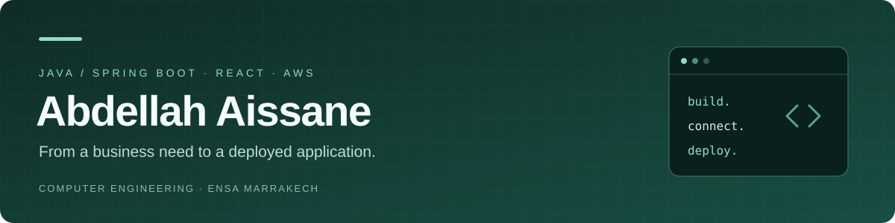

  

  
  

### A little about me

I’m **Abdellah**, a computer engineering student at **ENSA Marrakech, Morocco**. I build Spring Boot APIs and React interfaces, and take applications through deployment with Docker and AWS.

- **Backend:** REST APIs, microservices, authentication and role-based access.
- **Frontend:** React and TypeScript, with Tailwind CSS and shadcn/ui.
- **Beyond web apps:** real-time data pipelines with Kafka, Spark and BERT.

### Tools I work with

| Area | Technologies |
| :--- | :--- |
| Backend | Java · Spring Boot · Spring Security · Spring Cloud · Hibernate / JPA |
| Frontend | React · TypeScript · HTML · CSS · Tailwind CSS · shadcn/ui |
| Data | MySQL · PostgreSQL · Kafka · Spark · Elasticsearch |
| Delivery & cloud | Docker · Docker Compose · GitHub Actions · AWS EC2, S3 & Lambda |

### Selected work

#### [Real-time sentiment analysis](https://github.com/Sielxiter/BIGDATA-Sentiment-)
A cloud-native pipeline that collects YouTube comments, processes them with Kafka and Spark, classifies sentiment with a fine-tuned BERT model, and displays the results in Streamlit.

`YouTube Data API` → `Kafka` → `Spark + BERT` → `Elasticsearch` → `Streamlit`

#### University applications platform · Code212
Delivered a platform for university teaching applications at **Université Cadi Ayyad**: requirements gathering, four role-based areas, Spring Boot APIs, and Docker deployment with GitHub Actions.

[Visit the platform ↗](https://cand-mch2pes.uca.ma)

#### E-Learning platform · Cdigital
Contributed three Spring Boot business microservices, React interfaces, AWS S3 file storage, and containerised deployment on AWS EC2.

### From development to deployment

| Experience | What I worked on |
| :--- | :--- |
| **Cdigital** · Jul–Aug 2026 | Full Stack development · microservices · React · AWS |
| **Code212** · Apr–Jun 2026 | Full Stack & DevOps · university applications · CI/CD |

---

  <a href="https://abdellah-aissane-portfolio.vercel.app/">More about my work</a>
  &nbsp;·&nbsp;
  <a href="mailto:aissaneabdellah@gmail.com">Get in touch</a>

